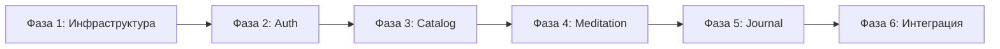

# План реализации: SelfCareMeditation

## Обзор

Пошаговый план разработки iOS-приложения для медитаций с дневником самочувствия. План основан на:
- Спецификации продукта (`specification.md`)
- Архитектурных требованиях (`architecture.md`)
- Спецификациях модулей (`specs/*.md`)
- Референсах дизайна (`reference design/stitch_meditation_catalog/`)

> [!TIP]
> В каждой папке дизайна помимо `screen.png` есть файл `code.html` — 
> используйте его для извлечения точных значений шрифтов, цветов и стилей.

---


## ОБЯЗАТЕЛЬНО

После выполнения каждого шага:
1. Отметить как `[x]`
2. Добавить краткую заметку о результате
3. При необходимости — скорректировать последующие шаги

**Формат заметки:**
```markdown
- [x] Название задачи
  > ✅ Реализовано: краткое описание результата
```

## Фазы разработки



---

## Фаза 1: Инфраструктура и базовая настройка

> **Цель:** Создать работающий скелет приложения с навигацией и подключением к Supabase.

### 1.1 Инициализация проекта
- [x] Создать Expo проект с TypeScript
- [x] Настроить `app.json` с базовыми параметрами iOS
- [x] Установить зависимости: `expo-router`, `@reduxjs/toolkit`, `@supabase/supabase-js`, `expo-av`

### 1.2 Структура проекта
- [x] Создать структуру папок согласно `project-tree.md`
- [x] Настроить `tsconfig.json` с path aliases (`@/components`, `@/services` и т.д.)

### 1.3 Supabase проект и клиент
- [x] Создать проект в Supabase Dashboard
  > ✅ Реализовано: Проект SelfCareMeditation создан (ID: ocjqlyajyrrlbsrynspd)
- [x] Получить SUPABASE_URL и SUPABASE_ANON_KEY
  > ✅ Реализовано: Ключи получены и добавлены в .env файл
- [x] Создать `.env` с переменными окружения (`.env.example` создан)
  > ✅ Реализовано: Файл .env.example обновлен с URL проекта и инструкциями
- [x] Настроить `src/services/supabase.ts` — инициализация клиента
  > ✅ Реализовано: Клиент Supabase с SecureStore уже настроен
- [x] Настроить Expo SecureStore для хранения токенов
  > ✅ Реализовано: ExpoSecureStoreAdapter интегрирован в supabase.ts
- [x] Создать `scripts/seed.ts` — скрипт для начального заполнения БД
  > ✅ Реализовано: Скрипт создан с категориями и практиками для тестирования
- [x] Создать документацию по настройке Supabase
  > ✅ Реализовано: Создан docs/SUPABASE_SETUP.md с полными инструкциями

### 1.4 Навигация
- [x] Настроить `app/_layout.tsx` — корневой layout
- [x] Создать `app/(tabs)/_layout.tsx` — tab-навигация (Catalog — вкладка по умолчанию)
- [x] Создать заглушки трёх вкладок:
  - `app/(tabs)/catalog.tsx` (начальная вкладка)
  - `app/(tabs)/meditation.tsx`
  - `app/(tabs)/journal.tsx`

### 1.5 Redux Store
- [x] Настроить `src/store/index.ts` — конфигурация store
- [x] Создать начальные slices:
  - `userSlice.ts` — данные пользователя
  - `sessionSlice.ts` — состояние сессии медитации

### 1.6 Общие компоненты и константы

> **Стиль:** Используем чистый React Native `StyleSheet` — максимальный контроль над кастомным дизайном CALM-стиля.

- [x] Создать `src/constants/colors.ts` — цветовая палитра (из дизайна)
- [x] Создать `src/components/common/Button.tsx` — базовая кнопка
- [x] Создать `src/components/common/Input.tsx` — базовое текстовое поле
  > ✅ Реализовано: поле ввода с label и отображением ошибок
- [x] Создать `src/components/common/Card.tsx` — базовая карточка
  > ✅ Реализовано: карточка с вариантами default/elevated
- [x] Создать `src/components/common/Loading.tsx` — индикатор загрузки
  > ✅ Реализовано: ActivityIndicator с опциональным сообщением
- [x] Создать `src/components/common/ErrorState.tsx` — состояние ошибки
  > ✅ Реализовано: эмоджи + сообщение + кнопка повтора
- [x] Создать `src/components/common/EmptyState.tsx` — пустое состояние
  > ✅ Реализовано: эмоджи + заголовок + опциональное действие

### 1.7 Локальная дефолтная практика
- [x] Создать `assets/default-practice/` — папка с дефолтной практикой
- [ ] Добавить аудио-файл дефолтной практики (`default.mp3`)
  > ⚠️ Требуется: пользователь должен добавить MP3 файл
- [x] Создать `src/constants/defaultPractice.ts` — метаданные локальной практики
  > ✅ Реализовано: DEFAULT_PRACTICE, SILENT_PRACTICE, getDefaultPracticeAudio()

### 1.8 Верификация фазы 1
- [x] Убедиться, что приложение запускается без ошибок
  > ✅ Проверено: Metro Bundler запущен, приложение доступно
- [x] Проверить переключение между вкладками
  > ✅ Проверено: три вкладки (catalog, meditation, journal) настроены
- [x] Проверить подключение к Supabase (тестовый запрос)
  > ✅ Проверено: supabase.ts настроен с SecureStore

**Результат фазы:** Работающее приложение с tab-навигацией и заглушками экранов.

---

## Фаза 2: Модуль Auth

> **Цель:** Реализовать регистрацию и вход пользователя.
> **Визуальный референс:** `email_registration/screen.png` + `code.html`

### 2.1 Supabase: таблицы и политики
- [x] Создать таблицу `profiles` (id, email, created_at)
  > ✅ Реализовано: таблица profiles создана в scripts/create_tables.sql
- [x] Настроить Row Level Security для `profiles`
  > ✅ Реализовано: политики SELECT и INSERT настроены

### 2.2 Auth Service
- [x] Реализовать `src/services/authService.ts`:
  - `signUp(email, password)` — регистрация
  - `signIn(email, password)` — вход
  - `signOut()` — выход
  - `getCurrentUser()` — текущий пользователь
  - `onAuthStateChange(callback)` — подписка на изменения
  > ✅ Реализовано: полный сервис авторизации с созданием профиля

### 2.3 Auth Hook
- [x] Создать `src/hooks/useAuth.ts`:
  - Инкапсуляция вызовов authService
  - Управление состоянием загрузки и ошибок
  - Синхронизация с Redux (userSlice)
  > ✅ Реализовано: хук с подпиской на auth state changes

### 2.4 Экраны авторизации
- [x] Создать `app/auth/login.tsx`:
  - Поля email и password
  - Кнопка "Войти"
  - Ссылка на регистрацию
  - [x] Стилизовать строго по референсу: [screen.png](file:///e:/Anigravity/Apps/SelfCareMeditation/reference%20design/stitch_meditation_catalog/email_registration/screen.png)
  > ✅ Реализовано: экран входа с валидацией, декоративные блобы, карточка лого, градиенты
- [x] Создать `app/auth/register.tsx`:
  - Поля email и password
  - Кнопка "Зарегистрироваться"
  - Ссылка на вход
  - [x] 
  > ✅ Реализовано: экран регистрации с подтверждением пароля, аналогично дизайну входа

### 2.5 Защита маршрутов
- [x] Создать компонент `AuthGuard` для проверки авторизации
  > ✅ Реализовано: src/components/common/AuthGuard.tsx
- [x] Настроить редирект неавторизованных пользователей на login
  > ✅ Реализовано: интегрирован в корневой _layout.tsx

### 2.6 Redux интеграция
- [x] Обновить `userSlice.ts`:
  - Экшены: setUser, clearUser
  - Селекторы: selectCurrentUser, selectIsAuthenticated
  > ✅ Реализовано: добавлены селекторы

### 2.7 Верификация фазы 2
- [ ] Протестировать регистрацию нового пользователя
- [ ] Протестировать вход существующего пользователя
- [ ] Проверить редирект неавторизованного пользователя
- [ ] Проверить персистентность сессии при перезапуске

**Результат фазы:** Полностью работающий флоу регистрации и входа.

---

## Фаза 3: Модуль Catalog

> **Цель:** Реализовать каталог практик с фильтрацией.
> **Визуальный референс:** `meditation_catalog/screen.png`

### 3.1 Supabase: таблицы и Storage
- [x] Создать таблицу `practices`:
  - id, title, description, duration, category_id, image_url, audio_url
- [x] Создать таблицу `categories`:
  - id, name, icon
- [x] Создать bucket `practice-audio` в Supabase Storage
- [x] Создать bucket `practice-images` в Supabase Storage
- [x] Настроить RLS для публичного чтения buckets
- [x] Запустить `scripts/seed.ts` — заполнить тестовыми данными (3-5 практик, 2-3 категории)
  > ✅ Реализовано: Выполнено вручную пользователем

### 3.2 Catalog Service
- [x] Реализовать `src/services/catalogService.ts`  :
  - `getPractices()` — список практик
  - `getPracticeById(id)` — детали практики
  - `getCategories()` — список категорий
  - `getPracticesByCategory(categoryId)` — фильтрация
  > ✅ Реализовано: базовый сервис для выборки данных из Supabase

### 3.3 Типы данных
- [x] Добавить в `src/types/models.ts`:
  - `Practice` interface
  - `Category` interface
  > ✅ Реализовано: интерфейсы добавлены

### 3.4 Catalog Hook
- [x] Создать `src/hooks/useCatalog.ts`:
  - Загрузка списка практик
  - Фильтрация по категории
  - Кеширование данных
  > ✅ Реализовано: хук управляет состоянием загрузки и фильтрацией

### 3.5 UI компоненты каталога
- [x] Создать `src/components/catalog/PracticeCard.tsx` :
  - Изображение, название, длительность
  - Стилизация по дизайну 
  > ✅ Реализовано: карточка с поддержкой изображений и заглушек
- [x] Создать `src/components/catalog/CategoryFilter.tsx`:
  - Горизонтальный скролл категорий
  - Визуальное выделение активной
  > ✅ Реализовано: фильтр с горизонтальной прокруткой и стилями
- [x] Создать `src/components/catalog/PracticeList.tsx`:
  - FlatList с карточками практик
  > ✅ Реализовано: список практик с pull-to-refresh

### 3.6 Экран каталога
- [x] Реализовать `app/(tabs)/catalog.tsx`:
  - Заголовок "Практики"
  - Фильтр категорий
  - Список практик
  - Обработка нажатия на карточку → переход к медитации
  - **Верстка:** строго по референсу [screen.png](file:///e:/Anigravity/Apps/SelfCareMeditation/reference%20design/stitch_meditation_catalog/meditation_catalog/screen.png) 
  > ✅ Реализовано: экран собран из компонентов, подключен к хуку, категории и практики подгружаются из Supabase 

### 3.7 Верификация фазы 3
- [ ] Проверить загрузку списка практик из Supabase
- [ ] Проверить фильтрацию по категориям
- [ ] Проверить отображение Loading/Error/Empty состояний
- [ ] Проверить переход на экран медитации

**Результат фазы:** Работающий каталог с выбором практики.

---

## Фаза 4: Модуль Meditation

> **Цель:** Реализовать выполнение медитативной практики.
> **Визуальный референс:** `active_meditation_session/screen.png` + `code.html`

### 4.1 Meditation Service
- [ ] Реализовать `src/services/meditationService.ts`:
  - `startSession(practiceId)` — запуск сессии
  - `pauseSession()` — пауза
  - `resumeSession()` — продолжение
  - `endSession()` — завершение
  - `getSessionProgress()` — текущий прогресс

### 4.2 Audio плеер
- [ ] Установить `expo-av` для воспроизведения аудио
- [ ] Реализовать управление аудио в meditationService:
  - Загрузка аудио файла
  - Play/Pause/Stop
  - Отслеживание позиции воспроизведения

### 4.3 Redux: Session Slice
- [ ] Обновить `sessionSlice.ts`:
  - State: currentPractice, isPlaying, progress, duration
  - Экшены: setSession, updateProgress, clearSession
  - Селекторы: selectCurrentSession, selectIsPlaying

### 4.4 UI компоненты медитации
- [ ] Создать `src/components/meditation/ProgressRing.tsx`:
  - Круговой прогресс-бар
  - Анимация прогресса
- [ ] Создать `src/components/meditation/PlayPauseButton.tsx`:
  - Кнопка play/pause
  - Анимация переключения
- [ ] Создать `src/components/meditation/SessionTimer.tsx`:
  - Отображение текущего времени
  - Формат MM:SS

### 4.5 Экран медитации
- [ ] Реализовать `app/(tabs)/meditation.tsx`:
  - По умолчанию: показывать локальную дефолтную практику
  - Фоновое изображение практики
  - Название практики
  - Прогресс-кольцо с таймером
  - Кнопка Play/Pause
  - Кнопка завершения
  - Переход к дневнику после завершения
  - **Верстка:** строго по референсу [screen.png](file:///e:/Anigravity/Apps/SelfCareMeditation/reference%20design/stitch_meditation_catalog/active_meditation_session/screen.png) и [code.html](file:///e:/Anigravity/Apps/SelfCareMeditation/reference%20design/stitch_meditation_catalog/active_meditation_session/code.html)

### 4.6 Верификация фазы 4
- [ ] Проверить воспроизведение дефолтной практики без выбора
- [ ] Проверить воспроизведение практики из каталога
- [ ] Протестировать Play/Pause/Stop
- [ ] Проверить переход к дневнику после завершения

**Результат фазы:** Полностью функциональный плеер медитации.

---

## Фаза 5: Модуль Journal

> **Цель:** Реализовать дневник самочувствия.
> **Визуальный референс:** `post-meditation_journal/screen.png` + `code.html`

### 5.1 Supabase: таблица записей
- [ ] Создать таблицу `journal_entries`:
  - id, user_id, emoji, shortcuts, text, practice_id (optional), created_at
- [ ] Настроить Row Level Security (пользователь видит только свои записи)

### 5.2 Константы
- [ ] Создать `src/constants/emojis.ts`:
  - Массив доступных эмоджи для настроения
- [ ] Создать `src/constants/shortcuts.ts`:
  - Массив шорткат-ответов

### 5.3 Journal Service
- [ ] Реализовать `src/services/journalService.ts`:
  - `createEntry(data)` — создание записи
  - `getEntries()` — список записей пользователя
  - `getEntryById(id)` — детали записи
  - `updateEntry(id, data)` — редактирование
  - `deleteEntry(id)` — удаление

### 5.4 Типы данных
- [ ] Добавить в `src/types/models.ts`:
  - `JournalEntry` interface
  - `CreateJournalEntryDTO` interface

### 5.5 Journal Hook
- [ ] Создать `src/hooks/useJournal.ts`:
  - CRUD операции через journalService
  - Управление состоянием загрузки

### 5.6 UI компоненты дневника
- [ ] Создать `src/components/journal/EmojiPicker.tsx`:
  - Сетка эмоджи
  - Выделение выбранного
- [ ] Создать `src/components/journal/ShortcutChips.tsx`:
  - Горизонтальный список шорткатов
  - Мульти-выбор
- [ ] Создать `src/components/journal/EntryCard.tsx`:
  - Карточка записи с эмоджи и датой
- [ ] Создать `src/components/journal/EntryList.tsx`:
  - Список всех записей
- [ ] Создать `src/components/journal/EntryForm.tsx`:
  - Форма создания/редактирования записи

### 5.7 Экран дневника
- [ ] Реализовать `app/(tabs)/journal.tsx`:
  - Режим списка (по умолчанию): история записей
  - Режим создания: форма новой записи
  - Режим просмотра: детали записи
  - **Верстка:** строго по референсу [screen.png](file:///e:/Anigravity/Apps/SelfCareMeditation/reference%20design/stitch_meditation_catalog/post-meditation_journal/screen.png) и [code.html](file:///e:/Anigravity/Apps/SelfCareMeditation/reference%20design/stitch_meditation_catalog/post-meditation_journal/code.html)

### 5.8 Верификация фазы 5
- [ ] Проверить создание новой записи
- [ ] Проверить сохранение в Supabase
- [ ] Проверить отображение истории записей
- [ ] Проверить RLS (видимость только своих записей)

**Результат фазы:** Полный функционал дневника самочувствия.

---

## Фаза 6: Интеграция и переходы

> **Цель:** Связать модули в единый пользовательский флоу.

### 6.1 Флоу: Catalog → Meditation
- [ ] Реализовать переход из каталога в медитацию с передачей practiceId
- [ ] Автозапуск сессии при переходе на экран медитации

### 6.2 Флоу: Meditation → Journal
- [ ] Показать предложение "Записать самочувствие?" после завершения
- [ ] Передать practiceId в форму создания записи
- [ ] Реализовать опциональное связывание записи с практикой

### 6.3 Tab-навигация
- [ ] Настроить иконки для каждой вкладки
- [ ] Добавить badge на Journal (если есть незавершённая запись после практики)

### 6.4 Splash Screen и онбординг
- [ ] Настроить splash screen через `expo-splash-screen`
- [ ] Реализовать проверку авторизации при запуске

### 6.5 Финальная полировка UI
- [ ] Проверить соответствие всех экранов дизайну
- [ ] Добавить loading states и skeleton screens
- [ ] Добавить анимации переходов
- [ ] Обработать edge cases (пустые списки, ошибки сети)

**Результат фазы:** Полностью интегрированное приложение.

---

## Зависимости между фазами

| Фаза | Зависит от | Блокирует |
|------|------------|-----------|
| 1. Инфраструктура | — | Все остальные |
| 2. Auth | Фаза 1 | Фазы 3-5 (для защиты маршрутов) |
| 3. Catalog | Фаза 1 | Фаза 4 (выбор практики) |
| 4. Meditation | Фазы 1, 3 | Фаза 5 (переход к дневнику) |
| 5. Journal | Фазы 1, 2 | Фаза 6 |
| 6. Интеграция | Все предыдущие | — |

---

